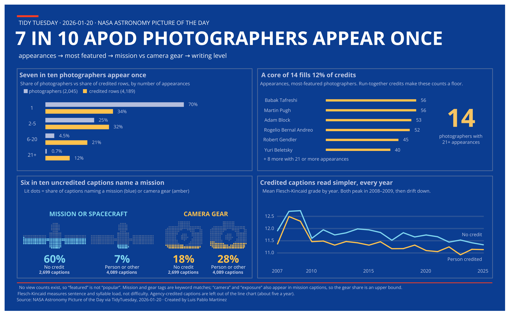

# Week 3: NASA Astronomy Picture of the Day (2026-01-20)

**Viz:** [APOD on Tableau Public](https://public.tableau.com/views/APOD/APOD)

Four panels on NASA's Astronomy Picture of the Day: who gets featured, the small core that fills the credit slots, what the captions talk about, and how simply they read. Hover any bar, line point or lit dot for the exact numbers.

**What the data shows:** 70% of the 2,045 credited photographers appear once, while 14 appear 21 or more times and fill 12% of credited rows. 60% of uncredited captions name a mission or spacecraft, against 7% of person-credited ones.

## How it fits together

1. `prep_apod.R` derives year, month, caption length and credit flags. The shared `R/scan_and_profile.R` and `R/eda_toolkit.R` profile the file before and after.
2. `analyze_apod.R` cleans the credits, computes the findings, and writes five small tables. Each headline number is checked with `stopifnot()`.
3. `build_apod_canvas.R` turns those tables into one CSV of drawing coordinates: bars, gridlines, dot-built icons, lines, labels and tooltip text. Icon shapes are drawn from masks, and every layout decision happens in R.
4. Tableau reads that CSV and draws each layer with `MAKEPOINT`.

## Run it

1. Download `apod.csv` from the [TidyTuesday week folder](https://github.com/rfordatascience/tidytuesday/tree/main/data/2026/2026-01-20) into `2026-01-20/drop/`. Data files are not stored in this repo.
2. In R, restore the packages: `renv::restore()`
3. Source `2026-01-20/prep_apod.R`, then `analyze_apod.R`, then `build_apod_canvas.R`.
4. In Tableau, hide background maps and fix the axes: longitude −16.25 to 16.25, latitude −10.0625 to 10.0625. Use a fixed 1300 × 805 dashboard.

`prep_apod.R` writes `apod_prepped.csv` next to the raw file in `drop/`. `analyze_apod.R` and `build_apod_canvas.R` write to `~/TableauData/Tidy Tuesday/`. Change the paths at the top of each script to use another folder.

## Notes on the data

- There are no view counts, so "featured" does not mean "popular."
- 44 calendar days are missing between 2007 and 2025 (19 of them in 2025).
- Credits are whitespace-cleaned only. Some run together ("Yuri BeletskyESO"), so counts per photographer are minimums.
- Mission and gear tags are keyword matches. "Camera" and "exposure" also appear in mission captions, so the gear share is an upper bound.
- Credits that name an agency (about 100 rows) are left out of the line chart because there are only about five a year.
- The captions are written by APOD's editors, so the readability gap reflects subject matter, not photographer style.
- Left-anchored text is placed from an estimated width, measured in the Tableau font family. Changing a font or size means re-measuring the constants.
- Best viewed on desktop.

## Credits

Data: NASA Astronomy Picture of the Day, via #TidyTuesday.