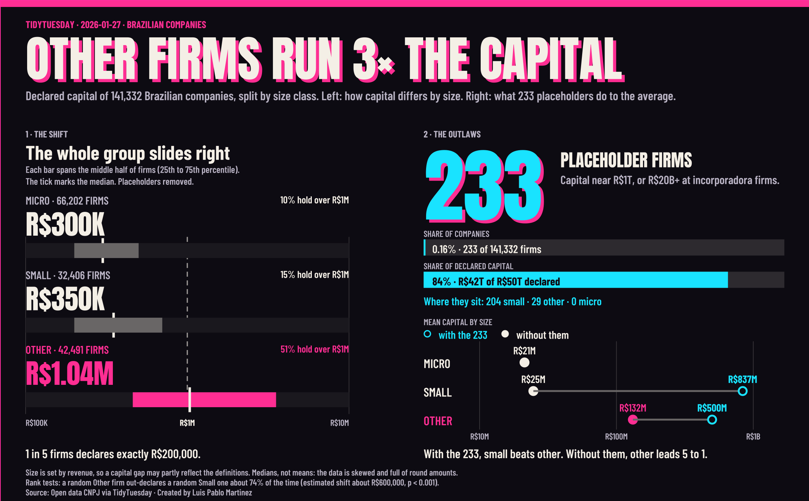

# Week 4: Brazilian companies (2026-01-27)

**Viz:** [Brazil Company Capital: The Shift and the 233 on Tableau Public](https://public.tableau.com/app/profile/luis.pablo6724/viz/BrazilCompanyCapitalTheShiftandthe233/BrazilCompanyCapitalTheShiftandthe233C)

Other-size firms declare about 3 times the median capital of small firms, and the whole distribution slides right, not just a few large companies. Then 233 placeholder firms, 0.16% of the 141,332, hold 84% of all declared capital (R$42T of R$50T). With them in, small firms look richest on average. Without them, Other leads 5 to 1.

## How it is built

The whole dashboard, type included, is drawn from one CSV of polygons that the R scripts generate. It has three layers: back (tracks, grid, shadows), data (bars, ticks, dots, rings, with the tooltips) and text. Tableau only draws the marks. Letters are converted to glyph outlines, so Anton and Barlow Condensed look the same everywhere. The shared geometry lives in `R/glyph_helpers.R`.

## Run it

1. Put the week's file in `2026-01-27/drop/`. Raw data stays on my machine and is not in the repo.
2. Source `clean_brazil.R`, then `Analyze_brazil.R` (writes the summary tables), then `build_brazil_canvas.R` (writes `brazil_canvas.csv`).
3. In Tableau, connect `brazil_canvas.csv` and build the three polygon layers.

All scripts write to `~/TableauData/Tidy Tuesday/`. Change `IN_FOLDER` at the top of each script to use another folder.

### Notes on the data

- Size classes (micro, small, other) are set by revenue, so a capital gap may partly reflect the definitions.
- The 233 placeholder firms all declare R$20B or more. They are removed from the percentile bars, the medians and the share holding over R$1M, and shown on their own in the right panel.
- The left panel uses medians, not means: the data is skewed and full of round amounts. About 1 in 5 firms declares exactly R$200,000.
- The headline "3x" is the Other-to-Small ratio of medians (2.96, rounded). "5 to 1" is the ratio of means without the 233 (5.34, rounded).
- Rank-sum tests (Wilcoxon, exact = FALSE because of tied amounts) compare the size classes with the placeholders removed. The estimated shift is the test's estimate, not the gap between the medians. The p-values print as 0, which means below machine precision, so read them as p < 0.001.

| Pair | Estimated shift | Chance a higher-class firm declares more |
|---|---|---|
| Other vs Micro | R$700,000 | 79% |
| Other vs Small | R$600,000 | 74% |
| Small vs Micro | R$40,000 | 58% |

## Credits

Data: Open data CNPJ via #TidyTuesday. Built in R and Tableau by Luis Pablo Martinez.
