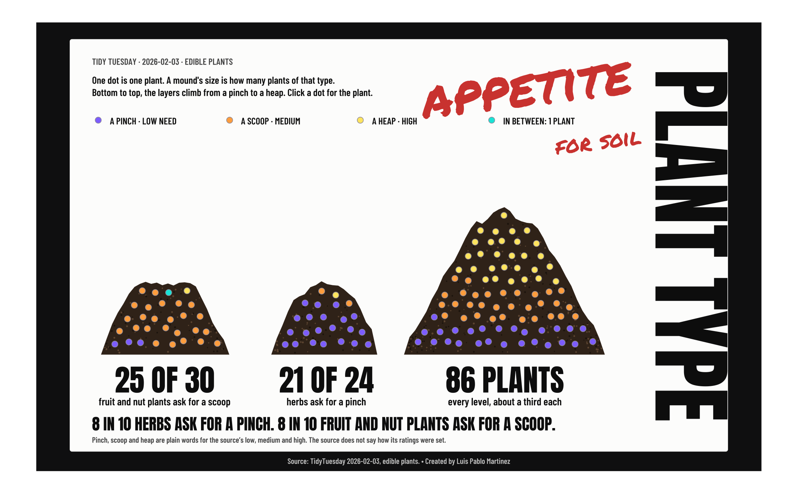

# Week 5: Edible Plants (2026-02-03)

**Viz:** [Plant type: appetite for soil on Tableau Public](https://public.tableau.com/app/profile/luis.pablo6724/viz/EdiblePlants/EdiblePlants)



One dot is one plant, 140 in all. The dots pile into three soil mounds (fruit and nut plants, herbs, and everything else), and each mound is layered from a pinch of soil at the bottom to a heap at the top. Eight in ten herbs ask for a pinch. Eight in ten fruit and nut plants ask for a scoop. The other 86 plants ask for all three levels in about equal parts. Click a dot to open that plant's card.

## How it was built

1. `clean_edible_plants.R` fixes spelling and category variants, splits ranges into min and max columns, and drops columns that are almost empty.
2. `analyze_edible_plants.R` finds the angle. It assigns each plant a type, counts the nutrient levels per type, tests whether "8 in 10" survives moving the borderline plants, and exports the tables the build needs. It refuses to finish if either share falls under 0.8.
3. `build_edible_plants_canvas.R` turns every mark into rows Tableau can draw: soil mounds, dots, lettering, and the card. Positions are written in map degrees, one dot per plant.
4. Tableau Public draws the rows. A parameter action opens the card on a click, and dynamic zone visibility shows and hides it.

The card text is drawn with a glyph atlas. Each distinct character is stored once as an outline (4,003 rows), and a layout table places every character of every card (23,492 rows). Drawing every letter of every card as its own polygons would need about 345,000 rows. On Tableau Public a dot click opens the card in about 2 seconds (median of 12 clicks).

## Run it

1. Get the data with `tidytuesdayR::tt_load("2026-02-03")` and save `edible_plants.csv` in `2026-02-03/drop/`. The raw file is not in this repo.
2. Install the fonts (free): Anton and Barlow Condensed (SIL Open Font License) and Permanent Marker (Apache 2.0). They go in `~/Library/Fonts`. For Permanent Marker:
   ```bash
   curl -L -o ~/Library/Fonts/PermanentMarker-Regular.ttf \
     https://raw.githubusercontent.com/google/fonts/main/apache/permanentmarker/PermanentMarker-Regular.ttf
   ```
3. Restore the packages with `renv::restore()`.
4. Source `clean_edible_plants.R`, then `analyze_edible_plants.R`, then `build_edible_plants_canvas.R`, each from a fresh R session.

The scripts write to `~/TableauData/Edible Plants/`. Change the paths at the top of each script to use another folder. The build needs `R/glyph_helpers.R`.

## Notes on the data

- The Tableau poster uses the source's own nutrient ratings (low, medium, high). The source does not say how they were set, and the poster says so.
- "Fruit and nut", "herb" and "other" are my groups. The source has no such column. Five borderline plants (Chives, Hops, Fennel, Horseradish, Lemon Grass) were tested in and out of the herb group, and both shares stay at or above 0.8.
- The TidyTuesday description says the database holds 146 species. The file has 140 rows.
- A few source spelling errors are left as they are, for example in two taxonomic names.
- Sunlight values are shortened for the card: "sun or shade", "part shade", "any light".

## Credits

Data: Edible Plant Database, GROW Observatory, via #TidyTuesday. Fonts: Anton, Barlow Condensed, Permanent Marker. The poster layout is inspired by the cover of Michael Jackson's *Bad* (1987); no artwork is used. Built in R and Tableau by Luis Pablo Martinez.
